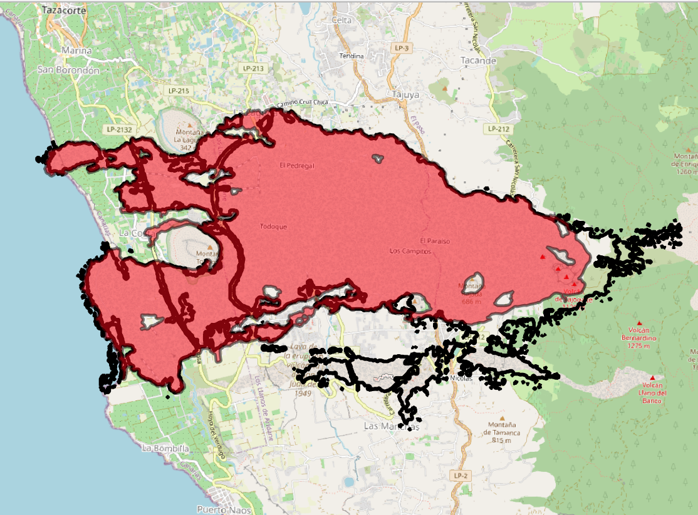
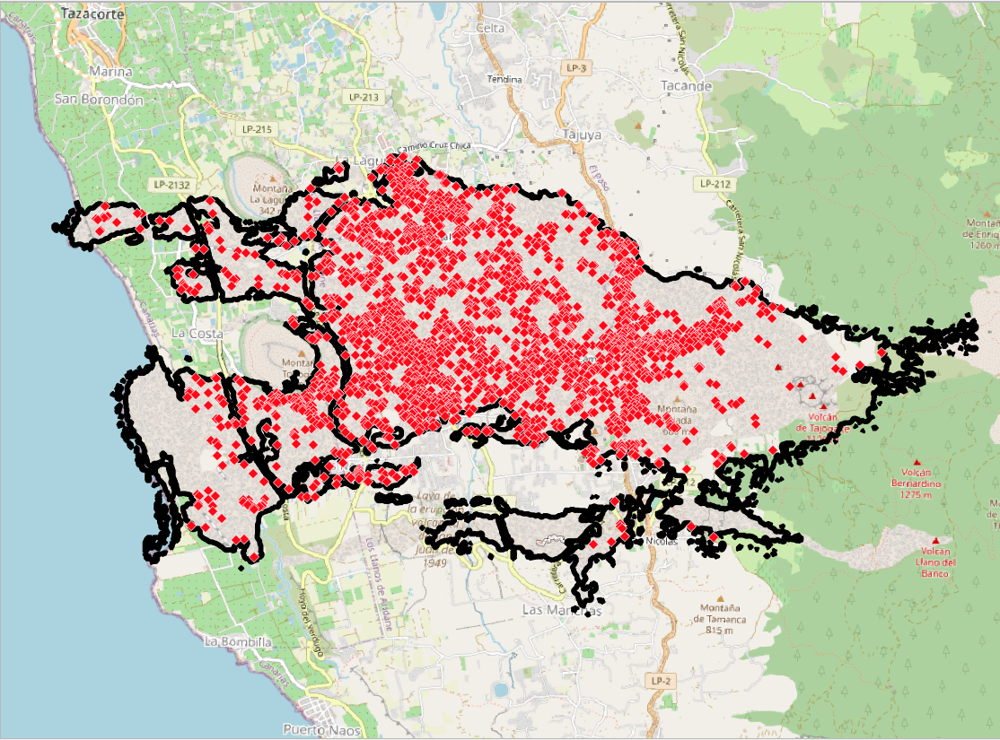
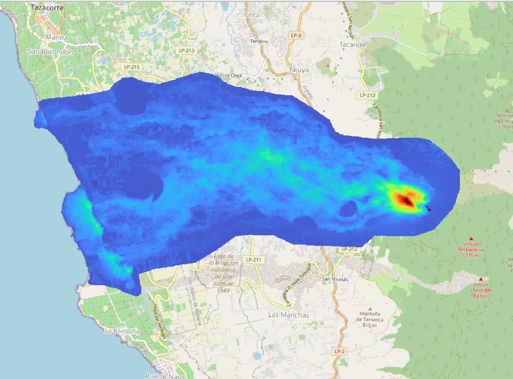

# Rapid Mapping: La Palma volcanic eruption

A Python workflow that reproduces, at a small scale, the kind of products delivered by the [Copernicus Emergency Management Service (CEMS) Rapid Mapping](https://emergency.copernicus.eu/mapping/) service: a delineation of the **extent of the 2021 Cumbre Vieja lava flow**, an assessment of the **buildings affected**, and the **terrain change** caused by the eruption. It combines airborne lidar, a Sentinel satellite image and pre/post-eruption elevation models. Results are saved as shapefiles and GeoTIFFs and, optionally, in a **PostGIS** database.

## Key results

| Output | Value |
|---|---|
| Lava flow extent | ~12.4 km² |
| Affected buildings | 3,126 |
| Building classification (Random Forest) | ~86 % accuracy* |


### Lava flow extent

Lava flow polygon extracted from a Sentinel image with K-Means and DBSCAN, covering **12.4 km²**.

### Affected buildings

Buildings detected from lidar with a Random Forest classifier (~86% accuracy on the test set) that intersect the lava flow: **3126 buildings**.

### Morphology change

Elevation difference between the pre-eruption terrain model and the post-eruption surface model (January 2022).

## Method

1. **Buildings from lidar.** A Random Forest is trained on the lidar point cloud (x, y, z) to predict the point classification. Points predicted as *building* (class 6) are rasterised (1.75 m cells), vectorised into polygons, and polygons under 10 m² are discarded. An alternative DBSCAN + convex-hull extraction is also provided.
2. **Lava flow from Sentinel.** K-Means (10 clusters) is applied to a Sentinel band. The cluster that represents lava is selected, DBSCAN removes isolated pixels, and an alpha shape gives the flow outline.
3. **Affected buildings.** Spatial join of building footprints with the lava polygon.
4. **Elevation change.** The post-eruption surface model (Jan 2022, 20 cm) is resampled onto the pre-eruption DTM grid (2 m) and the two are differenced.
5. **Storage.** Buildings, lava flow and affected buildings are written to PostGIS tables.

## Repository structure

```
.
├── la_palma.py              # the pipeline (command line)
├── tests/test_la_palma.py   # tests on synthetic data
├── requirements.txt         # pip dependencies
├── environment.yml          # conda dependencies (recommended on Windows)
├── docker-compose.yml       # local PostGIS database
├── .env.example             # database settings template
└── ...                      # notebook, presentation and images
```

## Author

Blitu82 · [GitHub profile](https://github.com/Blitu82)

## License

MIT, see [LICENSE](LICENSE).
